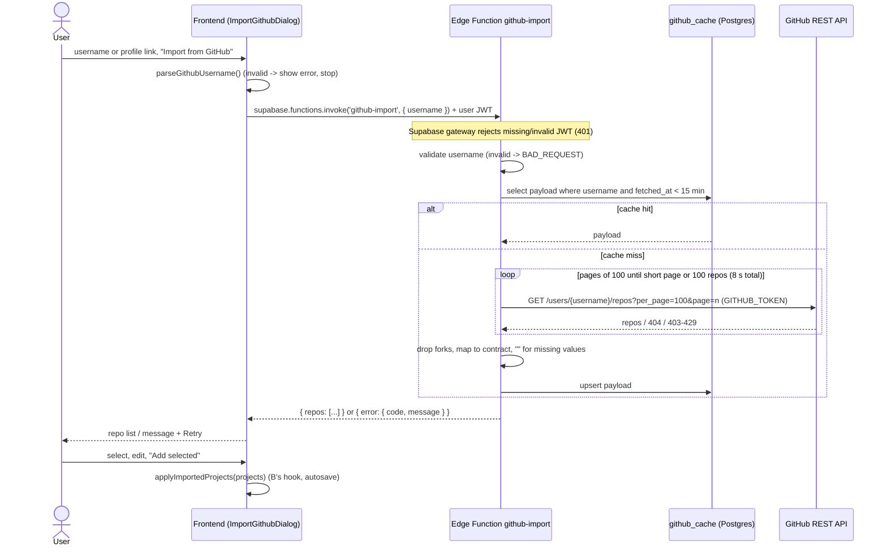

# Design: GitHub import (member C)

Part of the team design document. Collected by D.

## Use case: Import projects from GitHub

| | |
|---|---|
| **Actor** | Logged-in user |
| **Goal** | Add some of their public GitHub repositories as portfolio projects without typing them by hand. |
| **Precondition** | The user is signed in and has opened a portfolio in the builder. |
| **Trigger** | The user presses **Import from GitHub** in the Projects step. |

**Main flow**

1. The user enters a GitHub username or profile link (`https://github.com/name`) and presses **Import from GitHub**.
2. The app checks the input and calls the `github-import` Edge Function.
3. The function returns the user's public, non-fork repositories (at most 100).
4. The app lists them with a checkbox, name, description, language and stars. Nothing is selected.
5. The user selects repositories (or **Select all**) and can edit the name and description of each selected one.
6. The user presses **Add selected**. The projects are added to the portfolio and autosaved.

**Alternative flows**

- 1a. Invalid username or link: an error shows under the field; no request is sent.
- 3a. User not found, rate limited, timeout or no connection: a specific message and a **Retry** button are shown.
- 3b. No public repositories: an empty-state message is shown.
- 5a. A repository already in the portfolio (same `repoUrl`) is shown as "Already added" and cannot be selected.
- 5b. More repositories selected than the 20-project limit allows: **Add selected** is disabled with a message.
- At any time the user can close the dialog and add projects by hand. Import failures never block editing.

**Postcondition** The selected repositories appear as projects. Existing projects are not changed.

## Sequence diagram

## Decisions

- **Forks are excluded.** A fork is usually someone else's code; listing it would suggest work the user did not do.
- **Cap of 100 repositories**, sorted by last update, and at most 10 pages, so the import cannot hang.
- **One 8-second deadline for the whole import**, not per page.
- **Cache key is the lowercase username** (GitHub names are case-insensitive). The cache is only an optimisation: if it fails, the function still calls GitHub.
- **The username is validated twice**: in the browser (so bad input never costs a request) and in the function (never trust the client).
- **Nothing is added automatically**, and a fixed note warns that public data does not prove individual contribution.

## Errors the user can see

| Situation | Code | HTTP | Message in the dialog |
|---|---|---|---|
| Invalid username or link | `BAD_REQUEST` | 400 | Enter a valid GitHub username or profile link, for example "octocat" or "https://github.com/octocat". |
| User does not exist | `USER_NOT_FOUND` | 404 | No GitHub user with that name. Check the spelling and try again. |
| GitHub rate limit | `RATE_LIMITED` | 429 | GitHub is limiting requests right now. Wait a few minutes, then retry. |
| GitHub slower than 8 s | `TIMEOUT` | 504 | GitHub took too long to answer. Retry in a moment. |
| Other GitHub failure | `GITHUB_FAILED` | 502 | GitHub import failed. You can retry or add projects by hand. |
| No internet (frontend only) | `NETWORK` | — | Could not connect. Check your internet connection, then retry. |
| Session expired (gateway 401) | `UNAUTHORIZED` | 401 | Your session has expired. Sign in again, then retry. |
| No public repos | — (success, `[]`) | 200 | This account has no public repositories to import (forks are not included). |

`GITHUB_FAILED` is an addition to the four codes in CONVENTIONS section 8, for GitHub errors that fit none of them
(GitHub 5xx, a bad token). It matches `AI_FAILED` in the AI functions. `NETWORK` and `UNAUTHORIZED` exist only in the frontend helper.
